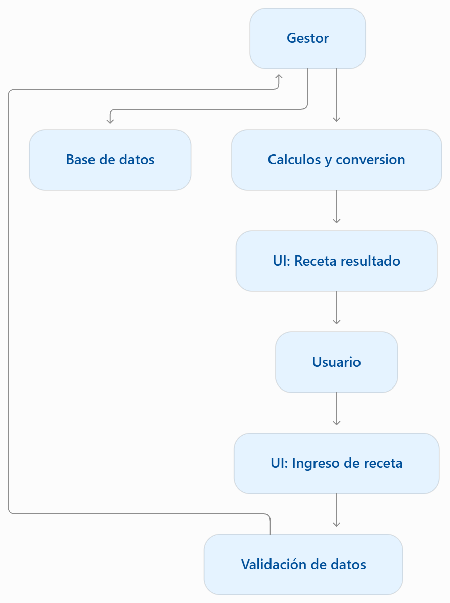

# Proyecto cheff

Flujo de los modulos de la aplicacion:

Paquetes:

| Paquete | Responsabilidad |
| --- | --- |
| model | Clases que representan ingredientes, recetas y moldes. |
| ui | Pantallas y elementos visuales de Compose. |
| manager | Coordina el proceso de validación, consulta de datos y cálculo. |
| logic | Realiza las operaciones matemáticas de conversión. |
| data | Acceso, almacenamiento y recuperación de datos. |
| navigation | Maneja el cambio entre pantallas. |

Orden recomendado por la ia para crear los archivos:
1. [ ] model → crear Ingrediente, Solid, Recipe y Mold.
2. [ ] logic → implementar y probar tus cálculos.
3. [ ] ui → crear la pantalla de ingreso visualmente.
4. [ ] ui → agregar campos y estados para almacenar entradas.
5. [ ] manager → crear el coordinador.
6. [ ] Conectar el botón de la UI al ViewModel.
7. [ ] Crear la pantalla de resultados.
8. [ ] navigation → conectar las dos pantallas.
9. [ ] data → implementar almacenamiento persistente cuando realmente lo necesites.